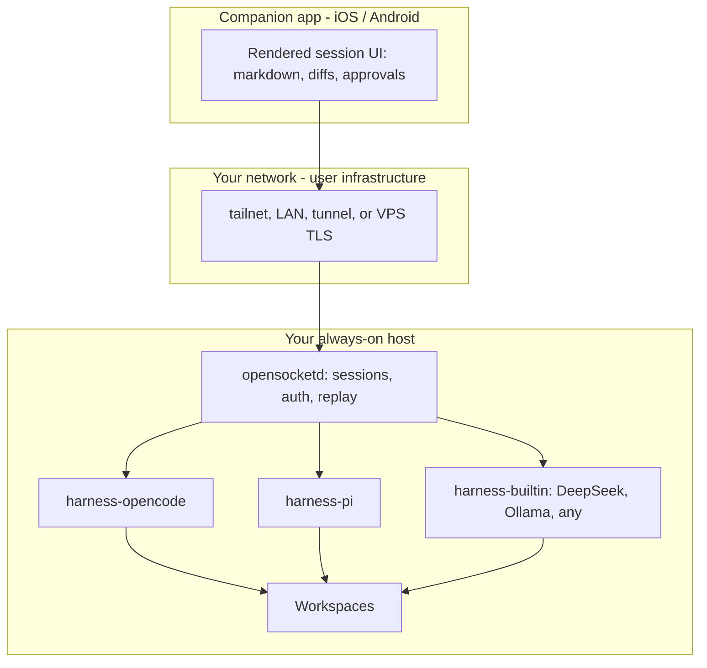

# OpenSocket — Project Plan

> An open-source alternative to Claude Cowork: your agents run on **your** always-on
> machine, use **open harnesses** (pi, Orchestra, OpenCode, DeepSeek, Ollama, …), and
> are driven from a **pleasant mobile companion app** over **your own network** —
> Tailscale, LAN, SSH tunnel, or a hosted box, whichever you already run. Nothing
> leaves your network unless you say so.

- **Status:** Draft v0.1 — 2026-10-06
- **License target:** Apache-2.0 (code), CC-BY-4.0 (docs)
- **Companion docs:** `docs/rfc/` (protocol specs), `docs/adr/` (decision records)

---

## 1. Problem

Claude Cowork pairs a capable desktop agent (files, tools, long-running tasks) with
polished clients — but it is closed:

- Claude models only; Anthropic infrastructure in the loop.
- No self-hosting; sessions live where Anthropic says they live.
- The client UI is theirs; no open protocol; no third-party clients.
- Mobile story is limited and terminal-ish workflows dominate the OSS space.

**OpenSocket** keeps the product shape and opens every layer:

| Layer      | Claude Cowork         | OpenSocket                          |
|------------|-----------------------|-------------------------------------|
| Host       | Anthropic-managed     | Your machine (desktop/homelab/VPS)  |
| Harness    | Claude agent          | OpenCode, pi, built-in, pluggable   |
| Models     | Claude only           | DeepSeek, Ollama, any OpenAI-compat |
| Transport  | Cloud relay           | Your network: Tailscale, LAN, tunnel, VPS |
| Client     | Closed apps           | Open companion app + protocol       |
| Sessions   | Vendor-held           | JSONL event logs you own            |

**Tagline:** *Your agents, on your network.*

---

## 2. Goals / Non-goals

### Goals (v1)

1. **Host daemon** (`opensocketd`) that creates, supervises, and persists agent sessions in project workspaces.
2. **Harness adapters** for OpenCode and pi, plus a small **built-in agent** (DeepSeek, Ollama, any OpenAI-compatible endpoint).
3. **One normalized event protocol** (OSSP) so every harness looks the same to clients.
4. **Mobile companion app** (iOS/Android) with a reading-first, rendered session UI — *not* a terminal: real typography, markdown, code blocks, diffs, tool cards, approvals.
5. **Bring-your-own transport** — the daemon is plain HTTP + tokens; reachability
   (LAN, Tailscale, SSH tunnel, hosted VPS) is user infrastructure. We ship
   recipes, not VPN code; pairing + per-device tokens make any of them safe.
6. **Sessions are event logs** (JSONL) — replayable, resumable, greppable, portable.
7. **Notifications without cloud lock-in** (ntfy / UnifiedPush; APNs/FCM optional bridge).

### Non-goals (v1)

- Not a general-purpose consumer chat app.
- Not a hosted/multi-tenant service.
- No VPN/tunnel integration code — reachability is user infrastructure;
  we ship connection recipes instead (LAN, Tailscale, SSH, VPS+TLS).
- No model hosting (bring providers, or run Ollama/vLLM yourself).
- No terminal emulator UI on mobile.
- No swarm/multi-agent orchestration yet.

---

## 3. Architecture



Flow: the phone connects over the user's network, picks a harness + model, sends a prompt;
the daemon runs the harness inside a workspace; harness events stream back through
OSSP; the phone renders them as proper text; approvals round-trip inline; the session
persists as an event log the app can resume from a snapshot.

---

## 4. Components

### 4.1 Host daemon — `opensocketd`

- **Runtime:** TypeScript, targeting **Bun** (M0 runs on Node ≥ 24 native
  type-stripping until Bun is available — no runtime-specific APIs in protocol).
  *Why:* OpenCode and pi are TypeScript with usable SDKs — one language across the
  daemon, adapters, shared protocol types, and the mobile app; Bun gives fast startup
  and single-binary builds. (Revisit in an ADR if a Go/Rust daemon ever becomes
  necessary; the protocol stays language-neutral.)
- **Responsibilities**
  - Session lifecycle: create / resume / list / interrupt / archive
  - Harness process supervision (spawn, health, restart, version pinning)
  - Workspace configuration: allowed roots per session, attachment staging
  - Event fan-out: WebSocket per client + HTTP SSE fallback; snapshot on join
  - Auth: pairing + per-device revocable tokens; optional proxy-provided
    identity headers (e.g. Tailscale WhoIS) when the user fronts the daemon
  - Usage accounting: tokens/cost per session, harness, model
  - Provider neutrality: the daemon never talks to model APIs; providers are a
    harness concern (see 4.2)
- **Storage:** `~/.opensocket/`
  - `sessions/<id>/events.jsonl` — append-only event log (the source of truth)
  - `sessions/<id>/session.log` — derived, human-readable transcript; safe to
    `tail -f` over SSH (the zero-client escape hatch, see 4.6)
  - `sessions/<id>/attachments/`
  - `state.db` (SQLite via `bun:sqlite`) — session index, devices, settings
- **API:** HTTP + WebSocket, documented via OpenAPI; a generated TypeScript client is
  shared by the mobile app and web PWA.

### 4.2 Harness adapters

**Design rule: everything about providers is handled by the harness.** The daemon
has no provider registry and never calls a model API itself; the protocol has no
provider concept. Each adapter fully owns provider discovery, config, API keys,
model catalogs, selection, requests, retries, fallbacks, rate limits, and
provider errors — OpenCode and pi already have mature provider ecosystems
(DeepSeek and Ollama included), and `harness-builtin` is the only component that
speaks to providers directly. The daemon shuttles opaque events; the phone
displays them. If clients ever need richer model metadata (pricing, context
window), it arrives as optional harness-reported annotations — never a
 daemon-side table.

Every harness is normalized to one interface:

```ts
interface Harness {
  id: string;
  capabilities(): Capabilities;        // tools, diffs, images, resume, checkpoints, models
  createSession(opts: SessionOpts): SessionHandle;
  resumeSession(id: string): SessionHandle;
  // SessionHandle emits OSSP events; accepts prompt / interrupt / permission responses
}
```

- **`harness-opencode`** (verified against v2.0.32): drive `opencode serve`
  over its v2 HTTP API. `POST /api/session` creates sessions scoped to the
  workspace directory (with ask-rules for side-effecting tools, so approvals
  round-trip), `POST /api/session/{id}/prompt` steers runs, and one shared
  `GET /api/event` SSE bus streams text deltas, tool calls, usage, and
  `permission.asked`/`replied` — mapped 1:1 onto OSSP. Auth is HTTP Basic
  (`opencode:<OPENCODE_PASSWORD>`). Resume is trivial: opencode owns session
  state, so the daemon just re-attaches the event bus to the stored
  `remoteSessionId`.
- **`harness-orchestra`** (validated reference, ships in M0): drive Orchestra's
  server — `POST /v1/agents` for sessions, `POST /v1/agents/{id}/stream` for
  runs. Its AgentEvent stream (thinking / generate_chunk / tool_call_* / done)
  maps almost 1:1 onto OSSP, and it owns its providers (R4-compliant). Brings
  multi-agent workflows to the phone later via `/v1/workflows/stream`. Known
  upstream gap: `AgentEvent.Error` is `json:"-"`, so errors stream without
  their message — flagged for an upstream fix.
- **`harness-pi`** (implemented in M0): drive the **pi coding agent**
  (`@earendil-works/pi-coding-agent`, the `pi` CLI) via `pi --mode rpc` —
  long-lived child process per session, strict JSONL on stdin/stdout, contract
  from the installed package's docs (rpc.md, json.md v1.2.0). Its event stream
  (text deltas, tool execution start/end, usage with cost, agent_settled) maps
  1:1 onto OSSP. Sessions are resumable: the daemon passes
  `--session-id/--session-dir` and records the pi session id in
  `session.started.remoteSessionId`, so a restarted daemon respawns with full
  agent context. Approvals (R3): the daemon loads `opensocket-approval.js`
  into pi, so every `tool_call` asks the daemon → client before executing;
  `PI_TOOLS` adds a spawn-time allowlist. Note: `ohmypi` does not exist on npm;
  **oh-my-pi** (v0.2.0, single-day release) is an orchestration layer over pi —
  evaluated and deferred: it duplicates orchestration OpenSocket owns at the
  daemon level and would couple the harness to an early project.
- **`harness-builtin`** (implemented): a small direct-to-provider **agent loop**
  with no subprocess — speaks the OpenAI streaming completions API, so it works
  with **DeepSeek, OpenRouter, OpenAI, Ollama, or the local mock**
  (`BUILTIN_BASE_URL`/`BUILTIN_API_KEY`/`BUILTIN_MODEL` env; defaults to the
  env's OpenRouter key when present). Tools: `read`/`ls` (workspace-rooted,
  auto-allowed) and `write`/`bash` (every call emits `permission.request` and
  blocks on the client's decision — deny/timeout blocks the tool, R3).
  Streaming tool-call accumulation, multi-turn tool loop (max 5), in-memory
  history; provider context restarts empty on daemon restart (the transcript
  persists in the JSONL).
- **Later candidates:** aider, gemini-cli, claude-code (license permitting).

Each adapter ships a **conformance test suite** (recorded fixtures → OSSP golden
files) so protocol churn in harnesses never leaks into clients.

### 4.3 OpenSocket Session Protocol (OSSP)

Event-sourced, additive-only, JSON-first. Spec lives in `docs/rfc/0001-ossp.md`.

**Events (daemon → client)**

| Type                 | Payload sketch                                  |
|----------------------|-------------------------------------------------|
| `session.started`    | id, workspace, harness, model                   |
| `message.delta`      | message id, text chunk, role                    |
| `message.completed`  | message id, final text, stop reason             |
| `tool.call`          | tool id, name, args summary, status             |
| `tool.result`        | tool id, result summary, detail ref             |
| `permission.request` | request id, tool, args, risk hints              |
| `permission.resolved`| request id, decision, scope                     |
| `diff`               | file path, hunks (add/del), apply state         |
| `todo.updated`       | checklist items + states                        |
| `usage`              | tokens in/out, cost estimate                    |
| `status`             | harness state (thinking/running/idle/error)     |
| `error`              | code, human message, retryable?                 |

**Requests (client → daemon)**

`session.create / resume / list`, `prompt.send`, `interrupt`,
`permission.respond`, `harness.list`, `model.list(harness)`,
`attachment.upload`, `file.list / file.read` (optional, read-only).

**Rules**

- Every event carries `id`, `ts`, `sessionId`; streams are replayable by sequence.
- Deltas are joined client-side; a snapshot of joined state is sent on (re)connect.
- Approvals are first-class. Harnesses that lack a permission system get an
  explicit daemon-side policy (auto-deny by default; allowlist per workspace).
- The protocol has no provider concept. Models are opaque, harness-reported
  descriptors (`model.list(harness)`); clients render them as-is.
- Additive evolution only; clients must tolerate unknown event types.

---

### 4.4 Transport & network — bring your own

**Principle:** the daemon is an ordinary HTTP + WebSocket server with token
auth. How the phone reaches it is **user infrastructure**, not product. We
maintain connection recipes and never ship VPN/tunnel code.

**Recipes (docs, one page each):**

- **LAN** — bind the daemon to the LAN, point the app at `http://<host>:8097`.
  Token-only auth; loudest warnings.
- **Tailscale** — install Tailscale on host + phone, `tailscale serve` the
  daemon, use the MagicDNS URL. WhoIS identity headers, if present, are an
  optional extra signal — never the only factor.
- **SSH tunnel** — `ssh -L 8097:localhost:8097 host` for quick remote use,
  plus plain `tail -f` on session logs with no client at all (see 4.6).
- **Hosted** — run the daemon on a VPS/box you control behind a TLS reverse
  proxy; fine for users whose "always-on machine" is rented.

**Pairing flow (M1, the product piece):** daemon prints a QR / 6-word code →
phone scans → a per-device token is minted (revocable, listed, scoped) →
done. No accounts, no cloud. A shared devsecret remains the quick-start
mode, loudly labeled as dev-only.

**Secrets:** model API keys belong to the harness that uses them — OpenCode and pi
read their own configs/env; `harness-builtin` keeps its provider keys in
`~/.opensocket/` (OS keychain where available). The daemon is not a secrets store,
and keys are never synced to or rendered on the phone.

### 4.5 Companion mobile app

**Stack:** Tauri 2 + TypeScript web frontend (Preact), per
[ADR 0001](docs/adr/0001-companion-app-stack.md) — supersedes the original
Expo choice (owner decision). Imports `packages/protocol` types and the shared
`packages/client`; the same frontend serves the desktop companion and web PWA.
Flutter is the documented fallback; iOS builds run in CI on a macOS runner
(no iOS toolchain exists on the Linux dev box — true for every framework).

**Design principle: it is a reading surface, not a terminal.**

UI spec:

- **Transcript** — role-grouped sections with real typography (system font, dynamic
  type), streaming text, full markdown: headers, lists, tables, blockquotes, links.
- **Code blocks** — monospace, syntax highlighting, language chip, horizontal scroll,
  one-tap copy.
- **Diff cards** — file header, colored add/remove hunks, expand/collapse; apply/keep
  state when the harness supports checkpoints.
- **Tool cards** — icon + name + one-line summary; tap to expand args/result; live
  spinner while running.
- **Approval cards** — inline *Allow once / Always for session / Deny* with plain-
  language risk hints ("will run: `rm -rf` in workspace").
- **Todo/plan widget** — live-updating checklist.
- **Composer** — multi-line input, attachments (files/images), harness + model chips,
  stop/interrupt, queue-next-prompt-while-running.
- **Sessions drawer** — list, resume, rename, archive; workspace switcher.
- **Status bar** — connection state, active harness/model, token & cost
  tally.
- **Theming** — system dark/light, generous whitespace, haptics on approvals; wide
  layout for iPad / desktop web later.

**Notifications:** in-app always; background via self-hostable **ntfy** or
**UnifiedPush** (FOSS path). APNs/FCM bridging is optional and documented as a
tradeoff (needs Apple/Google infrastructure).

**Reconnect behavior:** assume flaky mobile networks. On reconnect, request a joined
snapshot + tail, never full replay. Long sessions keep running on the host while the
phone is closed; a notification says why it stopped (awaiting approval / completed /
errored).

### 4.6 Log access & detachment — the `nohup` story

Sessions must survive the client vanishing. That is the daemon's job, not `nohup`'s:

- **Detachment happens once, at the daemon level.** Harnesses run as supervised
  child processes of `opensocketd` — closing the phone, dropping the tailnet, or
  killing the app never ends a session. What you detach is *the daemon itself*:
  run it under **systemd / launchd** (recommended) or `nohup opensocketd &` for
  quick starts. Per-session `nohup` would give one flat, unauthenticated stream
  with no approvals, no snapshot/reconnect, and no structure — strictly worse
  than supervised children writing structured logs.
- **Every session renders a plain-text `session.log`** next to its JSONL event
  log. This is the zero-client escape hatch:
  `ssh host -- tail -f ~/.opensocket/sessions/<id>/session.log`
  works with no app, no pairing, no protocol — for terminal people, CI, and
  debugging the daemon itself.
- **A thin CLI rides the same rails (M2+):** `opensocket tail <session>` follows
  the log file; `opensocket attach <session>` upgrades to the WS API for
  interactive driving from a laptop.
- **Logs are derived, never authoritative.** `session.log` can be regenerated
  from `events.jsonl` at any time; the JSONL stays the single source of truth.

---

## 5. Repository layout (monorepo)

```
opensocket/
  PLAN.md                  this file
  docs/
    rfc/                   protocol + design specs (0001-ossp.md first)
    adr/                   architecture decision records
  packages/
    protocol/              OSSP types, JSON Schemas, generated TS client
    harness-opencode/      OpenCode adapter
    harness-pi/            pi adapter
    harness-builtin/       direct-provider agent (DeepSeek, Ollama, …)
  apps/
    daemon/                opensocketd
    mobile/                Tauri 2 companion app (ADR 0001)
    web/                   thin PWA reusing the protocol client (M3)
  examples/
    connect.md             recipes: LAN, Tailscale, SSH tunnel, VPS + TLS
    opensocketd.service    systemd unit (or use nohup for quick starts)
    docker-compose.yml     host-side packaging
```

---

## 6. Roadmap

### M0 — Spike (weeks 1–2)
- No fake harness, no custom engine: real engines are the session layer —
  Orchestra's server (adapter validated against a contract test double) and
  `opencode serve` (adapter WIP, TODO against the installed version).
- opensocketd v0 is deliberately thin: device auth/pairing on the front, SSE
  fan-out in the middle, harness → OSSP translation + JSONL persistence on the
  back. Transcript renders in a plain web page.
- Open it from another device on your LAN — or any tunnel you already use.
- **Exit:** prompt from phone → agent on host → streaming markdown on phone,
  entirely on your network — with only a bridge between them.

### M1 — MVP "watch + drive" (weeks 3–6)
- Sessions: create/resume/list; the daemon's OSSP JSONL wraps opencode's own
  session storage (harness-agnostic source of truth); snapshot + resume on
  reconnect.
- `harness-opencode` complete with conformance fixtures.
- Pairing (QR + per-device revocable tokens).
- Companion app (Tauri 2, ADR 0001): transcript UI, streaming markdown + code rendering, interrupt,
  session list, status bar.
- **Exit:** daily-drivable for real code tasks at home.

### M2 — Approvals & more harnesses (weeks 7–10)
- Permission round-trip UI (approval cards, policies, allowlists).
- `harness-pi` adapter.
- `harness-builtin` with DeepSeek + Ollama providers.
- Diff cards + todo widget; ntfy notifications; usage/cost display.

### M3 — Polish (weeks 11–14)
- File/image upload to workspaces; multi-workspace support.
- Theming, iPad/wide layout; Docker install path; web PWA.
- Docs site; demo screencast.

### M4 — Ecosystem (weeks 15+)
- Public **harness plugin API**: out-of-process adapters over stdio JSON-RPC.
- Funnel share links; TestFlight / Play internal tracks.
- Security review checklist; tag **0.1.0** and publish.

---

## 7. Security & privacy

- **No public exposure by default.** Whatever transport the user picks, auth
  is per-device tokens (revocable); pairing uses a short-lived nonce. LAN
  mode is token-only, with louder warnings.
- **Auth = device token** (+ optional proxy-provided identity, e.g. Tailscale
  WhoIS, as a second signal when available).
- **Approval policy:** default-deny beyond read-only tools; per-session "always
  allow" scopes narrowly (per tool, per workspace).
- **Workspace sandboxing:** daemon-scoped roots per session; optional
  Docker/Firejail profile around harness processes (M3+).
- **Audit trail:** the JSONL session log *is* the audit trail; add export/redact tool.

---

## 8. Risks & mitigations

| Risk | Mitigation |
|---|---|
| Reachability is the user's problem | Users bring their own transport (LAN, tailnet, tunnel, VPS); we ship recipes, not VPN code |
| iOS/Android background limits kill streaming | State lives on the host; ntfy/UnifiedPush for "needs you"; fast snapshot resume |
| Harness APIs churn quickly | Version-pin adapters; conformance tests; OSSP isolates clients from churn |
| Approval fatigue → blind tapping | Default-deny, crisp risk labels, narrow "always" scopes |
| Scope creep into "yet another chat app" | Non-goals list; builtin agent stays deliberately small |
| Single-maintainer burnout | Small core protocol, plugin API early (M4), docs-first |

## 9. Open questions

- ~~Native (Swift/Kotlin) rewrite long-term, or Expo forever?~~ Answered by
  [ADR 0001](docs/adr/0001-companion-app-stack.md): Tauri 2 + TS frontend; a
  native Swift shell remains viable later because OSSP is transport-level.
- Multi-user households: share one daemon across users in v1, or single-user first?
- Voice input (Whisper on the host) — worth it for mobile ergonomics?
- Checkpoints/undo: normalize across harnesses, or pass through raw per-harness?
- License: Apache-2.0 vs MIT for the code.

## 10. Positioning & success criteria

**Positioning:** for people who want a Cowork-style agent experience but insist on
their own hardware, their own models (DeepSeek/local via Ollama included), their own
network, and an open protocol other clients can speak.

**v0.1 is successful when:**

1. A user goes from `git clone` → paired phone → completed real task in under
   15 minutes, over whatever network they already have.
2. The phone UI renders a full coding session readably — markdown, diffs, tool calls,
   approvals — with zero terminal screens.
3. At least two harnesses (OpenCode + pi) and two providers (DeepSeek API + Ollama)
   work through the same client.
4. Every session is a portable JSONL log the user can grep, replay, and delete.
